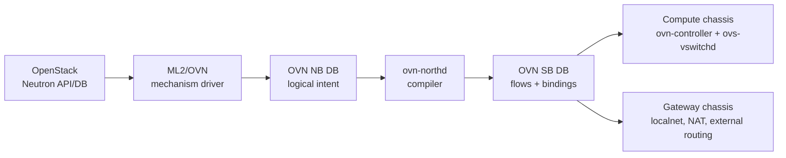
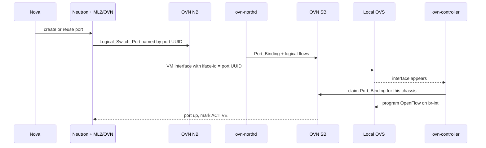
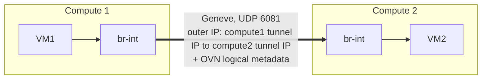

# OVN and Open vSwitch Engineering Handbook

_A single-file, offline handbook for engineers validating and troubleshooting OpenStack deployments using Neutron ML2/OVN. It emphasizes how intent moves from OpenStack to OVN databases, then to OpenFlow and the OVS datapath._

Neutron API → ML2/OVN → OVN NB → ovn-northd → OVN SB → ovn-controller → OVS/OpenFlow → datapath

Official-source basis: local OVN architecture/schema/manpages, OVS design/datapath/tracing docs, and OpenStack Neutron ML2/OVN docs/source. Synthetic outputs are labeled as examples.

## Chapter 1: OVN and OVS Architecture

Open vSwitch is the programmable virtual switch and datapath. OVN is a network virtualization control plane that programs OVS. In OpenStack ML2/OVN, Neutron owns cloud networking intent, OVN translates that intent into logical network behavior, and OVS executes the resulting packet-processing rules on each chassis.



### Control plane

Neutron, OVN databases, `ovn-northd`, `ovn-controller`, and OVSDB transactions. It decides what packet behavior should exist.

### Data plane

`ovs-vswitchd`, OpenFlow tables, tunnel ports, kernel or userspace datapath flows. It moves packets.

### Runtime state

Southbound `Chassis`, `Encap`, `Port_Binding`, `MAC_Binding`, and OVS Interface rows show what is actually bound and reachable.

### OVS vs OVN

| Layer | OVS | OVN |
|---|---|---|
| Purpose | Programmable switch with bridges, ports, interfaces, OpenFlow, tunnel ports, and datapath acceleration. | Network virtualization system that presents logical switches/routers/ACLs/NAT/load balancers and programs OVS on each chassis. |
| Databases | Local OVSDB, usually configured with `ovs-vsctl`; schema includes `Bridge`, `Port`, `Interface`. | Northbound database for desired logical network state; Southbound database for compiled logical flows, chassis, and binding state. |
| Main daemons | `ovsdb-server` and `ovs-vswitchd`. | `ovn-northd`, `ovn-controller`, NB/SB `ovsdb-server` instances. |
| Primary debug tools | `ovs-vsctl`, `ovs-ofctl`, `ovs-appctl ofproto/trace`, `ovs-appctl dpctl/dump-flows`. | `ovn-nbctl`, `ovn-sbctl`, `ovn-trace`, `ovn-appctl`. |

<details>
<summary>Why this distinction matters</summary>

If a VM port is missing in Neutron, OVN and OVS cannot fix it. If the logical switch port exists in NB but the SB `Port_Binding` is unbound, the problem is binding/chassis/runtime state. If the Port_Binding is bound but packets fail, you move down into OpenFlow, datapath, tunnels, MTU, and underlay. Good troubleshooting follows the data through layers instead of randomly restarting services.

</details>

### The Complete Neutron-to-OVS Configuration Process

1. User/Nova calls Neutron to create a network, subnet, port, router, security group, floating IP, or gateway.
2. Neutron ML2 plugin validates API state and invokes the OVN mechanism driver.
3. ML2/OVN writes OVN NB rows: `Logical_Switch`, `Logical_Switch_Port`, `Logical_Router`, `Logical_Router_Port`, `ACL`, `Port_Group`, `NAT`, `DHCP_Options`, `Load_Balancer`, or `HA_Chassis_Group`.
4. `ovn-northd` observes NB changes and compiles SB `Datapath_Binding`, `Port_Binding`, and `Logical_Flow` rows.
5. Every `ovn-controller` watches SB plus local OVSDB. It registers its chassis, advertises `Encap` tunnel IPs, claims local ports whose OVS `Interface.external_ids:iface-id` matches a logical port, and converts relevant logical flows into OpenFlow on `br-int`.
6. `ovs-vswitchd` executes OpenFlow and installs datapath flows in the kernel or userspace datapath.

```sh
# Inspect the chain from intent to local datapath
openstack port show <port-id>
ovn-nbctl list Logical_Switch_Port <port-id>
ovn-sbctl list Port_Binding <port-id>
ovs-vsctl --columns=name,external_ids list Interface
ovs-ofctl dump-flows br-int
ovs-appctl ofproto/trace br-int 'in_port=<ofport>,eth,ip,nw_src=10.0.0.10,nw_dst=10.0.0.20'
```

> **Healthy versus unhealthy:** A healthy compute has a stable chassis UUID, correct `Encap` IP, `Port_Binding.chassis` set for local VM ports, a matching OVS `iface-id`, and OpenFlow rules on `br-int`. Missing state at any layer narrows the fault domain.

## Chapter 2: Logical Networking

Logical networking is the abstraction layer that lets Neutron express tenant networks without directly programming each compute switch. Logical switches model L2 domains; logical routers model L3 forwarding; logical ports attach workloads, routers, localnet provider bridges, or special services.

### Logical Objects, Chassis, Encap, and Binding

| Object | Where | Role | Failure signal |
|---|---|---|---|
| `Logical_Switch` | NB | Tenant network or provider network abstraction. | Network missing from `ovn-nbctl show`. |
| `Logical_Switch_Port` | NB | VM NIC, router attachment, localnet port, virtual port. | Port absent or wrong addresses/security/options. |
| `Logical_Router` | NB | Neutron router for east-west and north-south routing. | Routes/NAT missing or gateway not scheduled. |
| `Chassis` | SB | A node running `ovn-controller`, identified by OVS `external_ids:system-id`. | Compute/gateway absent from `ovn-sbctl list Chassis`. |
| `Encap` | SB | Tunnel endpoint type/IP, usually Geneve over UDP 6081. | Wrong tunnel IP, underlay cannot reach tunnel endpoint. |
| `Port_Binding` | SB | Runtime binding row linking logical port to datapath and possibly chassis. | `chassis=[]` for a VM that should be local. |
| `iface-id` | OVSDB local | Join key on OVS Interface that claims an OVN logical port. | Nova tap exists but missing or wrong `external_ids:iface-id`. |
| `requested-chassis` | NB LSP option | Hint/constraint for where a logical port should bind; used by integrations including live migration flows depending on versions. | Port requested on unavailable chassis or stale migration state. |

```sh
ovn-sbctl --columns=name,hostname,encaps list Chassis
ovn-sbctl --columns=logical_port,type,chassis,datapath,options list Port_Binding <port-id>
ovs-vsctl --columns=name,ofport,external_ids list Interface
```

### Lifecycle of a VM Network Port



1. Nova asks Neutron for a port or uses an existing port. Neutron allocates MAC/IP/security-group state.
2. ML2/OVN creates a NB `Logical_Switch_Port` named as the Neutron port UUID, with addresses, port security, DHCP options, security group memberships, and metadata in `external_ids`.
3. `ovn-northd` creates or updates the SB `Port_Binding` and logical flows for the datapath.
4. Nova creates the VM interface on the compute node and sets local OVS Interface `external_ids:iface-id=<neutron-port-uuid>`.
5. The local `ovn-controller` sees the OVS interface and matching SB `Port_Binding`, sets the binding to its chassis, and programs OpenFlow on `br-int`.
6. Neutron observes binding/status events and marks the port active when the backend reports it is bound/up.

> **Key point:** Chassis registration is not the same as VM port binding. Chassis registration says a host exists and can participate in OVN. Port binding says a specific logical port has been claimed by a local OVS interface on a specific chassis.

## Chapter 3: OVS Internals

OVS is both a configuration database and a packet-processing engine. In OVN deployments, `ovn-controller` owns most flows on `br-int`; operators inspect them, but normally do not hand-edit them.

### br-int, br-ex, Bridges, Ports, Interfaces

`br-int` is OVN's integration bridge. VM tap/vhost-user interfaces, patch ports, localnet paths, and tunnel ports ultimately connect into the OVN pipeline here. `br-ex` is commonly an external/provider bridge connected to physical NICs or bonds, but exact naming is deployment-specific.

| OVSDB object | Meaning | Typical commands |
|---|---|---|
| `Bridge` | A switch instance such as `br-int` or `br-ex`. | `ovs-vsctl list Bridge` |
| `Port` | One logical switch port on a bridge; may contain one or more interfaces for bonds. | `ovs-vsctl list Port` |
| `Interface` | The actual endpoint: tap, system NIC, patch, Geneve, internal, DPDK, etc. | `ovs-vsctl list Interface` |

```sh
ovs-vsctl show
ovs-vsctl list Open_vSwitch
ovs-vsctl --columns=name,ports,external_ids list Bridge
ovs-vsctl --columns=name,type,ofport,options,external_ids list Interface
```

### Logical Flows vs OpenFlow vs Datapath Flows

| Layer | Producer | Tool | What it proves |
|---|---|---|---|
| OVN logical flows | `ovn-northd` | `ovn-sbctl lflow-list`, `ovn-trace` | Logical policy pipeline is compiled. |
| OpenFlow on OVS | `ovn-controller` | `ovs-ofctl dump-flows br-int`, `ovs-appctl ofproto/trace` | Local chassis installed executable switch rules. |
| Datapath/megaflow | `ovs-vswitchd` datapath caching | `ovs-appctl dpctl/dump-flows`, `ovs-dpctl dump-flows` | Kernel/userspace datapath has cached real packet fast-path entries. |

> **Do not confuse them:** A successful `ovn-trace` proves logical intent, not underlay reachability, host binding, MTU, firewall, or physical VLAN trunk correctness. A datapath flow is a cache result, not the original policy source.

## Chapter 4: Packet Forwarding and Geneve

OVN normally uses Geneve tunnels between chassis for overlay traffic. Geneve carries logical datapath metadata so the receiving chassis can continue the correct logical pipeline after decapsulation.

### VM1 on Compute 1 to VM2 on Compute 2



Inner Ethernet/IP stays VM1 to VM2 unless routed or NATed.

1. VM1 emits an Ethernet frame toward VM2. If same logical switch and remote binding, the source chassis knows VM2's binding chassis from SB state.
2. `br-int` applies OpenFlow generated from logical switch ingress/egress flows: port security, ACLs, L2 lookup, output pipeline.
3. OVS encapsulates the inner frame in Geneve. Outer source/destination are compute tunnel endpoint IPs from SB `Encap`. UDP destination is typically 6081.
4. The underlay routes the outer packet. Physical switches only need IP reachability and MTU for the larger encapsulated packet; they do not know tenant MAC/IP meaning.
5. Compute 2 decapsulates, uses Geneve metadata/logical datapath context, applies local OpenFlow, and outputs to VM2's local interface.

> **MTU:** Geneve adds outer Ethernet/IP/UDP/Geneve overhead and optional metadata. Neutron's OVN docs warn that Geneve `max_header_size` should account for OVN overhead; production MTU must be validated end to end.

### ovn-trace and ofproto/trace

#### `ovn-trace`

Runs a hypothetical packet through OVN logical pipelines. Use it to test ACLs, routing, NAT, L2 lookup, DHCP/DNS responders, and logical outputs. It does not prove the packet exists, the port is bound, or the underlay passes Geneve.

#### `ovs-appctl ofproto/trace`

Runs a packet through local OVS OpenFlow on a bridge. Use it after you know which chassis and interface are involved. It shows table traversal, final datapath actions, and megaflow.

```sh
# Logical trace: run from a host with OVN DB access
ovn-trace --ct new --summary <logical-switch> 'inport == "<lsp>" && eth.src == <mac> && ip4.src == 10.0.0.10 && eth.dst == <dst-mac> && ip4.dst == 10.0.0.20 && ip.ttl == 64'

# OVS local trace: run on selected compute/gateway
ovs-appctl ofproto/trace br-int 'in_port=<ofport>,eth(src=<mac>,dst=<mac>),ip,nw_src=10.0.0.10,nw_dst=10.0.0.20,nw_ttl=64'
```

## Chapter 5: OpenStack Neutron Integration

ML2/OVN replaces the traditional Neutron OVS agent/L3 agent model for OVN-backed networks. Neutron still owns API state, but OVN provides distributed switching/routing and programs OVS through `ovn-controller`.

### ML2/OVN vs ML2/OVS

| Topic | ML2/OVS traditional | ML2/OVN |
|---|---|---|
| Compute agent | Neutron OVS agent programs OVS. | `ovn-controller` programs OVS from OVN SB DB. |
| L3 routing | Often Neutron L3 agent namespaces, DVR/HA variations. | OVN logical routers with distributed routing and scheduled gateway behavior. |
| Security groups | iptables/hybrid or OVS firewall driver depending deployment. | OVN ACLs and conntrack compiled into logical flows/OpenFlow. |
| Port binding | ML2 OVS agent reports/binds via agent mechanisms. | OVN Port_Binding plus local OVS `iface-id` and chassis state. |

OpenStack operations become OVN rows through functions in Neutron's OVN client: networks become logical switches; ports become logical switch ports; DHCP-enabled subnets create `DHCP_Options`; routers create logical routers and LRPs; security groups create port groups and ACLs; floating IPs create `dnat_and_snat` NAT rows.

### Provider Networks, VLANs, Bridge Mappings, Metadata, DHCP, DNS

Tenant overlay networks use Geneve between chassis. Provider networks connect logical networks to real external L2 segments using localnet ports and bridge mappings. A flat/VLAN provider network only works on a chassis if the required physical network is present in OVN bridge mappings.

```sh
# On compute/gateway: inspect bridge mappings and tunnel config
ovs-vsctl get Open_vSwitch . external_ids:ovn-bridge-mappings
ovs-vsctl get Open_vSwitch . external_ids:ovn-encap-type
ovs-vsctl get Open_vSwitch . external_ids:ovn-encap-ip

# In OVN: inspect localnet/provider ports and chassis gateway eligibility
ovn-nbctl find Logical_Switch_Port type=localnet
ovn-sbctl --columns=name,external_ids list Chassis
```

DHCP and DNS may be native OVN behavior depending on Neutron configuration. Metadata is handled by OVN metadata support/agent/extension depending release and deployment. Debug DHCP by checking `DHCP_Options` references on the LSP, security group allowances, and logical flows for DHCP responders. Debug metadata by checking the metadata port, routes to `169.254.169.254`, and local metadata service logs.

## Chapter 6: Routing, Gateways, and NAT

OVN routing is logical and distributed, but north-south traffic still requires a gateway path to physical networks. The hard part in production is not adding a router; it is validating gateway chassis eligibility, provider VLAN reachability, SNAT/FIP behavior, and return routing.

### Distributed Logical Routing

East-west routing between tenant networks can happen on the source or destination chassis without hairpinning through a network node, because logical router flows are installed where needed. North-south traffic exits through gateway-capable chassis connected to provider networks. Distributed gateway ports and gateway chassis scheduling determine where external egress/ingress is handled.

### SNAT, DNAT, Floating IPs, Static Routes, Return Paths

| Feature | OVN object | What to verify |
|---|---|---|
| SNAT | `NAT type=snat` on logical router. | Logical IP CIDR, external IP, gateway chassis, upstream route back to external IP range. |
| Floating IP | `NAT type=dnat_and_snat`; may include logical port/MAC for distributed FIP depending config. | External IP, internal fixed IP, logical port, allowed physical network mappings. |
| DNAT/port forwarding | Version/feature dependent; may use NAT or LB-like objects depending service. | Do not assume; inspect Neutron feature and OVN rows. |
| Static route | `Logical_Router_Static_Route`. | Prefix, next hop, output port/policy, reachable next hop. |

```sh
ovn-nbctl lr-route-list <router>
ovn-nbctl lr-nat-list <router>
ovn-nbctl list Logical_Router_Port
ovn-nbctl list Gateway_Chassis
ovn-nbctl list HA_Chassis_Group
```

<details>
<summary>VM-to-Internet packet walkthrough</summary>

VM sends to its default gateway MAC. OVN logical router decrements TTL, rewrites Ethernet source to router port MAC, decides route toward external network, applies SNAT if configured, and outputs toward a gateway/localnet path. OVS sends the packet to the provider bridge/NIC/VLAN. The upstream router must know how to return to the SNAT/FIP address range, usually because that range is on the provider network or routed to the gateway.

</details>

<details>
<summary>Internet-to-VM floating IP walkthrough</summary>

External packet arrives on provider VLAN toward the floating IP. Gateway chassis receives it, OVN identifies the router/provider path, applies DNAT to the fixed IP, then routes/logically delivers to the VM's chassis. Return traffic must be reverse-translated consistently; asymmetric routing or gateway failover bugs often appear as SYN reaching the VM but SYN-ACK disappearing.

</details>

## Chapter 7: Security and Connection Tracking

Neutron security groups map to OVN port groups and ACLs. Stateful behavior depends on connection tracking. ACL errors frequently look like routing failures until you trace both ICMP and TCP with connection-state assumptions.

### ACLs, Port Security, Allowed Address Pairs, Conntrack Zones

Neutron ingress security-group rules map to OVN `to-lport` ACLs; egress maps to `from-lport`. Stateful allow rules use connection tracking actions so return traffic can be allowed by established state. Port security restricts allowed MAC/IP pairs; allowed address pairs extend what addresses a port is allowed to source or receive for VIP/failover use cases.

```sh
ovn-nbctl list Port_Group
ovn-nbctl acl-list <logical-switch-or-port-group>
ovn-sbctl lflow-list <datapath> | grep -i acl
ovs-ofctl dump-flows br-int | grep ct
ovs-appctl dpctl/dump-conntrack
```

> **Conntrack zones:** OVN/OVS uses zones to separate state between logical ports/datapaths. Do not interpret a generic conntrack entry without considering zone and translated addresses.

### Why ICMP Works While TCP Fails

Common causes: security group allows ICMP but not TCP port; TCP SYN reaches destination but return SYN-ACK is blocked by egress/ingress ACL; MTU blackhole affects larger TCP but not small ping; asymmetric routing breaks conntrack; port security rejects a VIP source; provider firewall blocks TCP while allowing ICMP.

1. Confirm Neutron security group rules for protocol/port/direction.
2. Inspect NB ACLs and port groups generated for the port.
3. Run `ovn-trace --ct new` for the TCP SYN and reverse direction.
4. Run `ofproto/trace` on the bound chassis.
5. Capture on VM tap, `br-int`, Geneve interface/underlay NIC, and provider bridge if north-south.
6. Check MTU with DF pings and TCP MSS clamping expectations.

## Chapter 8: High Availability

OVN HA has two separate planes: database/control-plane HA and gateway/data-plane HA. A production readiness review must test both and document what fails open, what fails closed, and what only affects new changes.

### OVN NB/SB OVSDB Clustering

OVSDB clustered service uses quorum and leader election. With quorum, writes require a majority. Existing OVS datapath flows continue forwarding during many control-plane outages, but new Neutron changes, new port bindings, and reconciliation may stop or lag.

```sh
ovn-appctl -t /var/run/ovn/ovnnb_db.ctl cluster/status OVN_Northbound
ovn-appctl -t /var/run/ovn/ovnsb_db.ctl cluster/status OVN_Southbound
ovn-nbctl --timeout=5 show
ovn-sbctl --timeout=5 show
```

| Failure | Existing traffic | New operations | Evidence |
|---|---|---|---|
| One DB node down in 3-node cluster | Usually continues. | Continues if quorum remains. | Cluster status shows member missing but leader/quorum healthy. |
| NB unavailable/no quorum | Existing programmed traffic may continue. | Neutron cannot reliably write new intent. | `ovn-nbctl` timeouts, Neutron OVN DB errors. |
| SB unavailable | Existing OpenFlow may continue temporarily. | Binding changes, chassis updates, new flow distribution break. | `ovn-controller` disconnected; stale Port_Binding/chassis. |

### Gateway HA, HA_Chassis_Group, BFD, Upgrades

Gateway HA chooses eligible chassis for router gateway/external traffic. OVN NB has `HA_Chassis_Group` and `Gateway_Chassis` concepts; BFD can detect chassis-to-chassis failures for tunnel/gateway reachability. OpenStack gateway eligibility also depends on bridge mappings and chassis options such as gateway enablement.

```sh
ovn-nbctl list HA_Chassis_Group
ovn-nbctl list HA_Chassis
ovn-nbctl list Gateway_Chassis
ovn-sbctl list BFD
ovn-sbctl --columns=name,external_ids list Chassis
```

> **Safe upgrades:** Verify compatibility matrix for deployed OpenStack, OVN, and OVS. Upgrade clustered databases/control plane carefully, maintain quorum, avoid mixing features that older controllers cannot understand, and test port binding, gateway failover, metadata, DHCP, FIPs, and security groups before declaring success.

## Chapter 9: Production Troubleshooting

The best troubleshooting method is layer-by-layer evidence collection: OpenStack API state, OVN NB intent, OVN SB compiled/binding state, local OVSDB, OpenFlow, datapath, packet captures, and physical underlay.

### Diagnostic Walkthroughs

| Scenario | Symptoms | Diagnostic order and commands | Root causes and safe recovery |
|---|---|---|---|
| VM port exists but is unbound | Neutron port DOWN, VM has tap, no connectivity. | `openstack port show`; `ovn-nbctl list LSP`; `ovn-sbctl list Port_Binding`; on compute `ovs-vsctl list Interface`. | Missing/wrong `iface-id`, stale requested chassis, chassis absent, Nova binding issue. Fix Nova/libvirt/OVS interface metadata; avoid manually forcing SB binding except emergency with clear rollback. |
| Same-compute VMs cannot communicate | No overlay needed, ping fails. | Check both LSPs, port security, ACLs, local `ofproto/trace`, tap ofports, VM ARP tables. | Security group, port security MAC/IP mismatch, missing local OpenFlow. Restart/reconcile `ovn-controller` only after collecting evidence. |
| Different-compute VMs cannot communicate | Same network works locally but not remote. | All same-compute checks plus `ovn-sbctl list Encap`, underlay ping between tunnel IPs, UDP 6081 firewall, MTU, Geneve capture. | Wrong tunnel IP, blocked UDP 6081, underlay route/MTU issue, stale chassis. |
| VM does not receive IP | DHCP discover no offer. | Check subnet DHCP enabled, `DHCP_Options`, LSP `dhcpv4_options`, ACL egress, `ovn-trace` UDP 68→67. | DHCP options missing, restrictive SG, metadata/DHCP disabled for port type. Re-sync Neutron/OVN or fix port/subnet config. |
| VM has IP but no Internet | East-west OK, north-south fails. | Router routes/NAT, gateway chassis, provider bridge mappings, localnet port, upstream ARP/routes, capture on br-ex/provider NIC. | No SNAT/default route, gateway chassis ineligible, provider VLAN trunk missing, upstream return path absent. |
| Floating IP unreachable | External host cannot reach VM FIP. | `lr-nat-list`, FIP association, gateway chassis, provider ARP, SG ingress, reverse trace, upstream route. | NAT row missing/wrong logical port, SG blocks, provider network not present on gateway, asymmetric return. |
| Metadata unavailable | cloud-init timeout at 169.254.169.254. | Check metadata service/agent, metadata port, routes/DHCP option 121, SG egress, local logs, trace to metadata IP. | Metadata disabled, metadata port missing, route absent, service not listening, SG blocks link-local traffic. |
| Geneve blocked | Remote overlay fails; local traffic OK. | Underlay ping, `tcpdump udp port 6081`, firewall, encap IPs, MTU DF tests. | Firewall/ACL blocking UDP 6081, wrong tunnel endpoint network, asymmetric underlay routing. |
| MTU mismatch | Ping works small; TCP stalls; large packets drop. | DF ping sizes, Neutron network MTU, VM MTU, physical MTU, Geneve overhead, TCP MSS. | Network MTU too high for underlay, provider trunk MTU lower, guest not receiving correct MTU. |
| OVS flow programming incorrect | NB/SB look right but local forwarding wrong. | `ovn-controller` logs, `ovs-ofctl dump-flows`, `ofproto/trace`, check SB connection and local OVSDB. | Controller disconnected/stale, version mismatch, local OVSDB corruption, resource exhaustion. Restart controller only after confirming it can reconnect. |
| Gateway chassis failure | North-south outage or failover delay. | HA chassis group, gateway chassis priorities, BFD, chassis liveness, provider bridge on backup, upstream ARP refresh. | Backup lacks bridge mapping/VLAN, BFD not detecting, upstream stale MAC. Fix eligibility and test failover. |
| SB DB unavailable | Controllers disconnected; new ports fail. | Cluster status, leader/quorum, controller logs, TCP connectivity to SB endpoints. | Lost quorum, network partition, cert/TLS issue. Restore quorum/connectivity; do not wipe DB. |
| Security group blocks traffic | Specific protocol/port fails. | Neutron SG rules, port group membership, ACL list, `ovn-trace --ct new`, reverse direction. | Missing ingress/egress rule, remote group expansion issue, stale ACL sync. Update SG and verify ACLs. |
| External provider VLAN misconfigured | Provider network ports fail on some hosts. | Bridge mappings, physical switch trunk VLANs, OVS port trunks/tag, localnet port, LLDP/switch config. | Wrong physnet name, VLAN not trunked, host not eligible for binding. |
| Asymmetric routing/conntrack | SYN reaches, reply lost; intermittent NAT. | Capture both directions, check gateway selection, NAT zone/state, upstream ECMP, return route. | Return path bypasses same NAT/gateway state. Fix routing symmetry or distributed FIP design. |

Example healthy output patterns: `Port_Binding.chassis` is non-empty for local VM ports; `Chassis.encaps` shows correct tunnel IP; `ovn-nbctl lr-nat-list` shows expected NAT rows; `ovs-vsctl get Interface tap... external_ids:iface-id` returns the Neutron port UUID. Unhealthy outputs are empty rows, stale UUIDs, wrong physnet/tunnel IP, or timeouts.

### Synthetic Healthy and Unhealthy Outputs

These are labeled examples for interpretation practice, not captured production evidence.

#### Healthy bound VM port

```sh
# Example output: healthy
$ ovn-sbctl --columns=logical_port,chassis,type list Port_Binding 8b0f-port
logical_port        : 8b0f-port
type                : ""
chassis             : [compute-02]

$ ovs-vsctl get Interface tap8b0f external_ids:iface-id
"8b0f-port"
```

The SB binding and local OVS interface agree on the port identity. Now troubleshoot packet policy or forwarding, not binding.

#### Unhealthy unbound VM port

```sh
# Example output: unhealthy
$ ovn-sbctl --columns=logical_port,chassis,type list Port_Binding 8b0f-port
logical_port        : 8b0f-port
type                : ""
chassis             : []

$ ovs-vsctl get Interface tap8b0f external_ids:iface-id
ovs-vsctl: no row "tap8b0f" in table Interface
```

The logical port exists but no chassis has claimed it. Look at Nova/libvirt interface creation, local OVS, `iface-id`, and `ovn-controller` connectivity.

#### Healthy Geneve underlay

```sh
# Example output: healthy
$ ovn-sbctl --columns=type,ip list Encap
type                : geneve
ip                  : "192.0.2.11"

$ ping -M do -s 1550 192.0.2.12
64 bytes from 192.0.2.12: icmp_seq=1 ttl=63 time=0.4 ms
```

The encap IPs are routable and a DF test sized for your physical MTU succeeds. Continue to OVN policy or host binding.

#### Unhealthy provider mapping

```sh
# Example output: unhealthy
$ ovs-vsctl get Open_vSwitch . external_ids:ovn-bridge-mappings
"physnet-storage:br-storage"

$ openstack network show public -c provider:physical_network
provider:physical_network="physnet-public"
```

The host lacks the physnet required by the provider network. Flat/VLAN provider binding or gateway traffic cannot work on this chassis until bridge mappings and physical trunks match.

### Interactive Troubleshooting Cases

#### Case 1: Neutron port is ACTIVE in API, but the VM cannot send traffic.

What is the next best layer to verify after confirming the NB logical switch port exists?

- Provider VLAN
- Port_Binding
- Octavia logs

<details>
<summary>Answer</summary>

**Port_Binding** Correct: inspect SB `Port_Binding` and local OVS `iface-id`. You need to know whether the port is bound to the expected chassis before debugging underlay.

</details>

#### Case 2: VM pairs on the same compute communicate; VM pairs across computes do not.

Which evidence is most directly relevant?

- UDP 6081
- Nova flavor
- DNS zone

<details>
<summary>Answer</summary>

**UDP 6081** Correct: cross-compute overlay requires Geneve underlay reachability, typically UDP 6081 plus correct tunnel endpoint IPs and MTU.

</details>

#### Case 3: Ping to a VM succeeds but SSH fails.

What should you do before blaming routing?

- ACL trace
- Delete router
- Disable all gateways

<details>
<summary>Answer</summary>

**ACL trace** Correct: compare ICMP and TCP in security groups/OVN ACLs with `ovn-trace --ct new` and reverse-path analysis.

</details>

## Chapter 10: Deployment Validation and Production Readiness

Acceptance means more than “instances ping.” You need a repeatable checklist that proves physical design, OVN control plane, host binding, overlay/underlay, provider networks, HA, security, and operations are production-ready.

### OpenStack OVN Acceptance Checklist

| Check | Commands | Expected result | Failure indicators |
|---|---|---|---|
| Physical NICs, bonds, VLAN trunks | `ip link`, switch config, `ovs-vsctl show` | Redundant links up, trunk VLANs allowed, provider NICs attached to expected bridge. | Down bond member, missing VLAN, wrong bridge. |
| Bridge mappings | `ovs-vsctl get Open_vSwitch . external_ids:ovn-bridge-mappings` | All gateway/compute roles have required physnet mappings. | Physnet absent or typo causes provider binding failure. |
| OVN DB cluster health | `ovn-appctl cluster/status`, `ovn-nbctl show`, `ovn-sbctl show` | Leader, quorum, low latency, no repeated elections. | No quorum, timeouts, split brain symptoms. |
| Chassis registration | `ovn-sbctl list Chassis` | Every compute/gateway present with correct hostname, encap, external IDs. | Missing chassis, duplicate system-id, wrong encap IP. |
| Geneve endpoints | `ovn-sbctl list Encap`, underlay ping, `tcpdump udp port 6081` | Endpoint IPs reachable, firewall permits Geneve, MTU supports overlay. | Packet loss, blocked UDP, fragmentation blackhole. |
| Port binding | `ovn-sbctl list Port_Binding`, `ovs-vsctl list Interface` | VM ports bind to expected chassis and iface-id matches port UUID. | Unbound ports, stale requested chassis, wrong iface-id. |
| MTU | Neutron network MTU, guest MTU, DF pings | Guest MTU accounts for Geneve/provider overhead. | Large TCP stalls, DF ping failures. |
| DHCP and metadata | `ovn-nbctl list DHCP_Options`, VM cloud-init logs, metadata logs | VM gets IP, routes, DNS, metadata. | No offer, no route to 169.254.169.254, metadata timeout. |
| Security groups | OpenStack SG rules, `ovn-nbctl acl-list`, `ovn-trace --ct` | Allowed ingress/egress works; denied traffic blocked. | ACL missing/stale, ICMP/TCP mismatch. |
| East-west connectivity | Same host and cross-host tests, traces, captures | L2 same subnet, L3 across tenant subnets works. | Local works but remote fails: suspect Geneve/underlay. |
| North-south and FIPs | `lr-route-list`, `lr-nat-list`, provider captures | VM→Internet and Internet→FIP paths work with return symmetry. | SNAT/FIP row missing, upstream route absent, gateway not eligible. |
| Gateway HA | Disable active gateway, monitor failover, `HA_Chassis_Group`, BFD | Traffic resumes within accepted interval; backup has provider access. | Backup lacks VLAN/bridge mapping, stale ARP, no failover. |
| Monitoring/logging | Service logs, DB metrics, flow counts, chassis count, alert rules | Alerts for DB quorum, controller disconnects, gateway failure, tunnel loss. | No operational visibility or runbooks. |

## Command Reference

| Command | Purpose | Where | Example output meaning |
|---|---|---|---|
| `ovn-nbctl show` | Summarize NB logical switches/routers/ports. | Controller/admin host | Missing object means Neutron did not write intent or sync failed. |
| `ovn-nbctl list Logical_Switch_Port <id>` | Inspect port addresses, security, options, DHCP, external IDs. | Admin host | Wrong addresses or missing DHCP options explain guest failures. |
| `ovn-sbctl list Port_Binding <id>` | Inspect runtime binding state. | Admin host | `chassis=[]` means unbound; wrong chassis means stale/misplaced binding. |
| `ovn-sbctl list Chassis` | Show registered nodes and capabilities. | Admin host | Missing chassis means controller registration/connectivity failure. |
| `ovn-sbctl list Encap` | Show tunnel endpoint IP/type. | Admin host | Wrong IP causes cross-host overlay failure. |
| `ovn-trace --ct new` | Simulate logical packet with stateful behavior. | Admin host | Shows logical drop/output/NAT decisions, not real underlay delivery. |
| `ovs-vsctl show` | Inspect local OVS bridges/ports/interfaces. | Compute/gateway | Confirms br-int/br-ex, patch/tunnel/provider interfaces. |
| `ovs-vsctl list Interface` | Inspect ofport, type, options, external_ids. | Compute/gateway | Verify tap has `iface-id` equal to Neutron port UUID. |
| `ovs-ofctl dump-flows br-int` | Dump local OpenFlow. | Compute/gateway | Proves controller programmed the OVS bridge. |
| `ovs-appctl ofproto/trace br-int ...` | Trace local OpenFlow pipeline. | Compute/gateway | Shows matched OpenFlow tables/actions and resulting datapath action. |
| `ovs-appctl dpctl/dump-flows` | Inspect cached datapath/megaflows. | Compute/gateway | Useful for actual fast-path evidence; not original policy. |
| `ovs-appctl dpctl/dump-conntrack` | Inspect conntrack state. | Compute/gateway | Use with zones/NAT awareness for ACL/NAT debugging. |
| `tcpdump -ni any udp port 6081` | Observe Geneve underlay traffic. | Compute/gateway | Packets leaving but not arriving suggest underlay/firewall problem. |
| `ovn-appctl cluster/status` | Check OVSDB cluster leader/quorum. | DB node | No leader/quorum explains write failures and controller disconnects. |

## Glossary

| Term | Meaning |
|---|---|
| OVN | Open Virtual Network: a logical network virtualization control plane for OVS. |
| OVS | Open vSwitch: programmable virtual switch and datapath. |
| OVSDB | Database protocol/server used by OVS and OVN for configuration and runtime state. |
| NB DB | OVN Northbound database containing desired logical configuration. |
| SB DB | OVN Southbound database containing compiled flows, chassis, and binding state. |
| ovn-northd | Daemon that compiles NB state into SB logical flows and bindings. |
| ovn-controller | Per-chassis daemon that programs OVS from SB and local OVSDB state. |
| ovs-vswitchd | OVS switching daemon that executes OpenFlow and talks to datapaths. |
| Geneve | Overlay encapsulation protocol used by OVN to carry tenant traffic and metadata between chassis. |
| Chassis | An OVN node, usually a compute or gateway, registered in SB by ovn-controller. |
| Encap | SB row describing tunnel type and endpoint IP for a chassis. |
| Datapath | Logical datapath in OVN or low-level OVS datapath depending context; always clarify layer. |
| iface-id | OVS Interface external_id that matches an OVN logical port name. |
| Port_Binding | SB row representing runtime state and chassis binding for a logical port. |
| ML2 | Neutron Modular Layer 2 plugin framework. |
| NAT | Network address translation; OVN supports snat, dnat, dnat_and_snat rows. |
| BFD | Bidirectional Forwarding Detection, used for fast failure detection. |
| br-int | OVN integration bridge in OVS. |
| br-ex | Common external/provider bridge name for physical network access. |
| localnet | OVN port type connecting a logical network to a provider/physical network. |
| OpenFlow | Programmable switch rule model used by OVS. |
| Datapath flow | Cached fast-path flow in kernel/userspace datapath. |
| ACL | OVN access control list row, used for security groups and policies. |
| Port Group | OVN grouping of logical ports, often used for Neutron security groups. |
| DHCP_Options | OVN NB row providing native DHCP options to logical switch ports. |
