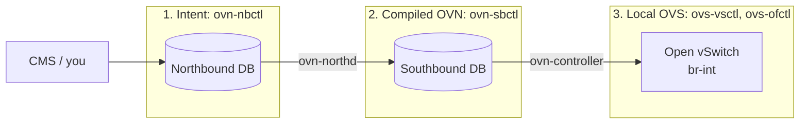

# Find The Three Surfaces

_Your first OVN skill: know whether a command is looking at intent, compiled OVN state, or local Open vSwitch state._

## The Model

OVN configuration flows from north to south. The local [`ovn-architecture.7`](../../ovn/ovn-architecture.7) manual describes this as: CMS intent enters the **OVN Northbound DB**, `ovn-northd` translates it into the **OVN Southbound DB**, and `ovn-controller` programs local Open vSwitch.

For now, compress that to three surfaces:



### 1. Intent

`ovn-nbctl` reads and writes the logical network you asked OVN to create.

### 2. Compiled OVN

`ovn-sbctl` reads what `ovn-northd` produced for controllers.

### 3. Local OVS

`ovs-vsctl` and `ovs-ofctl` inspect what exists on the local virtual switch.

## Sandbox Exercise

First start the sandbox from the repo root. It builds OVS and OVN if needed, then opens a **new shell** inside `ovn/tutorial` with `ovn-nbctl`, `ovn-sbctl`, `ovs-vsctl` and friends on `PATH`. Your normal shell does not have these tools.

```sh
./sandbox.sh
```

Every lesson command runs inside that shell. Type `exit` to leave it, and run `./sandbox.sh cleanup` to stop its daemons and wipe its state.

In the sandbox shell, run these commands. Do not worry if the output is dense. Your job is only to label the surface.

```sh
./ovn-setup.sh
ovn-nbctl show
ovn-sbctl show
ovs-vsctl show
```

Expected observation: `ovn-nbctl show` should mention logical switches and a logical router from the tutorial topology. `ovn-sbctl show` should show chassis/Southbound information. `ovs-vsctl show` should show local OVS bridge/configuration state.

## Retrieval Check

Answer from memory before peeking back at the model.

**1.** Which surface does `ovn-nbctl show` inspect?

- Local OVS state
- Northbound intent
- Southbound flows

<details>
<summary>Answer</summary>

**Northbound intent**

</details>

**2.** Where should you look for state compiled by `ovn-northd`?

- Northbound intent
- Local OVS state
- Southbound flows

<details>
<summary>Answer</summary>

**Southbound flows**

</details>

**3.** Which surface is closest to actual switching behavior on this sandbox chassis?

- Southbound flows
- Local OVS state
- Northbound intent

<details>
<summary>Answer</summary>

**Local OVS state**

</details>

## What To Read

Primary source: [OVN sandbox tutorial](../../ovn/Documentation/tutorials/ovn-sandbox.rst), especially “Running the sandbox” and “Creating OVN Resources.” Keep [the control-plane map](../reference/0001-ovn-control-plane-map.md) open as a reference.

One manual per surface, worth skimming the command list of each:

- Intent: [ovn-nbctl(8)](https://www.ovn.org/support/dist-docs/ovn-nbctl.8.html)
- Compiled OVN: [ovn-sbctl(8)](https://www.ovn.org/support/dist-docs/ovn-sbctl.8.html)
- Local OVS: [ovs-vsctl(8)](https://www.openvswitch.org/support/dist-docs/ovs-vsctl.8.txt)

In the sandbox shell, `man ovn-nbctl`, `man ovn-sbctl` and `man ovs-vsctl` show the same pages for your exact build.

If any command output is confusing, ask the agent to explain that exact output. That is the fastest way to connect the model to the real sandbox.
