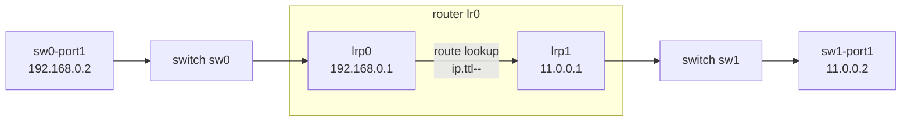

# Trace One Packet

_Your next OVN skill: describe what OVN would do to a packet before you look at OpenFlow._

## The Model

`ovn-trace` does not send a real packet. It asks OVN to evaluate a hypothetical packet through the logical pipeline described in the Southbound database.

In the tutorial topology, one packet starts on `sw0-port1`, enters the logical router through `lrp0`, exits through `lrp1`, and lands on `sw1-port1`.


### Start

`sw0-port1`  
MAC `50:54:00:00:00:01`  
IP `192.168.0.2`

### Router

`lr0`  
`lrp0`: `192.168.0.1`  
`lrp1`: `11.0.0.1`

### Finish

`sw1-port1`  
MAC `50:54:00:00:00:03`  
IP `11.0.0.2`

## Sandbox Exercise

In your running sandbox shell, make sure the tutorial topology exists, then trace one packet.

```sh
./ovn-setup.sh

ovn-trace --minimal sw0 'inport == "sw0-port1" \
&& eth.src == 50:54:00:00:00:01 && ip4.src == 192.168.0.2 \
&& eth.dst == 00:00:00:00:ff:01 && ip4.dst == 11.0.0.2 \
&& ip.ttl == 64'
```

If `./ovn-setup.sh` says an object already exists, that is fine. You already created the topology in the previous lesson, so run only the `ovn-trace` command.

## Expected Win

The minimal trace should show these three logical actions:

```text
ip.ttl--;
eth.src = 00:00:00:00:ff:02;
eth.dst = 50:54:00:00:00:03;
output("sw1-port1");
```

Read that as: OVN routed the packet, rewrote the Ethernet header for the destination network, and chose `sw1-port1` as the logical output port.

## Retrieval Check

Answer from memory before peeking back at the trace.

**1.** What does `ovn-trace` process?

- Physical packet flow
- Hypothetical packet
- Interface counters

<details>
<summary>Answer</summary>

**Hypothetical packet**

</details>

**2.** What does `ip.ttl--` tell you happened?

- Dropped by ACLs
- Broadcast to ports
- Decremented TTL

<details>
<summary>Answer</summary>

**Decremented TTL**

</details>

**3.** What does `output("sw1-port1")` identify?

- Logical output
- Kernel datapath
- Northbound schema

<details>
<summary>Answer</summary>

**Logical output**

</details>

## What To Read

Primary source: [OVN sandbox tutorial](../../ovn/Documentation/tutorials/ovn-sandbox.rst), section “Using ovn-trace.” Keep the [`ovn-trace` cheatsheet](../reference/0002-ovn-trace-cheatsheet.md) and [control-plane map](../reference/0001-ovn-control-plane-map.md) nearby.

If your trace output differs, ask the agent to explain the exact output. That is usually a clue about which logical fields did or did not match.
