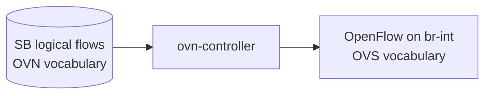

# Find Local OpenFlow

_Your next OVN skill: separate logical flows from the OpenFlow installed into local Open vSwitch._

## The Model

Lesson 3 showed that `ovn-northd` writes Southbound logical flows. The next daemon in the chain is `ovn-controller`. It runs on the chassis and translates relevant Southbound data into OpenFlow on the integration bridge, `br-int`.



This lesson is not about mastering OpenFlow syntax. It is about recognizing when you have crossed from OVN's logical vocabulary into OVS's local forwarding vocabulary.

## Sandbox Exercise

Run these in your sandbox shell and compare the shape of the output.

```sh
ovn-sbctl lflow-list sw0

ovn-sbctl --ovs lflow-list sw0

ovs-ofctl dump-flows br-int
```

If `ovn-sbctl --ovs lflow-list sw0` prints only logical flows, try `sw1` or `lr0`. A datapath only has local OpenFlow when this sandbox chassis has relevant local bindings for it.

## What To Notice

### `lflow-list`

Uses logical names and OVN actions: `inport`, `outport`, `next;`, `output;`.

### `--ovs`

Can show the OpenFlow rows below their corresponding logical flow rows.

### `dump-flows`

Shows local OVS rules with `table`, `metadata`, `reg`, and `actions`.

## Retrieval Check

Answer from memory before peeking back at the model.

**1.** Which daemon translates Southbound logical flows into local OpenFlow?

- ovn-controller
- ovn-northd
- ovn-nbctl

<details>
<summary>Answer</summary>

**ovn-controller**

</details>

**2.** Which sandbox bridge receives the installed OpenFlow?

- sw0
- br-int
- lr0

<details>
<summary>Answer</summary>

**br-int**

</details>

**3.** What does `ovn-sbctl --ovs lflow-list` add when local flows exist?

- OpenFlow rows
- NB schema rows
- Kernel modules

<details>
<summary>Answer</summary>

**OpenFlow rows**

</details>

## What To Read

Primary source: [local OpenStack tutorial](../../ovn/Documentation/tutorials/ovn-openstack.rst), the section that explains `ovn-controller` translating logical flows into OpenFlow. Keep the [local OVS/OpenFlow map](../reference/0004-local-ovs-openflow-map.md) and the [Bridge / Port / Interface reference](../reference/0009-ovs-bridge-port-interface.md) nearby.

If the OpenFlow output looks alien, that is expected. Ask the agent to decode one line at a time.
