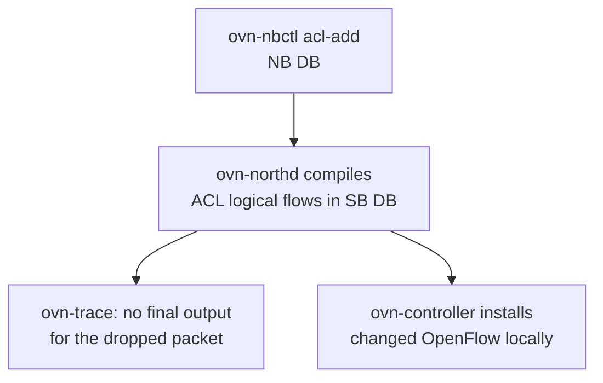

# Add One ACL

_Your next OVN skill: change Northbound intent and watch the change move into logical flows and trace behavior._

## The Model

So far you have mostly observed OVN. Now you will change it. An ACL is Northbound intent: *traffic matching this expression should get this verdict*.



The important move is not memorizing every ACL table. It is seeing one small policy change ripple across the surfaces from Lesson 1.

## Sandbox Exercise

Run this from the sandbox shell after `./ovn-setup.sh`. First, add one ACL to `sw0`:

```sh
ovn-nbctl --wait=sb --may-exist acl-add sw0 from-lport 1001 \
  'inport == "sw0-port1" && ip4.dst == 11.0.0.2' drop
```

Check the Northbound intent:

```sh
ovn-nbctl acl-list sw0
```

Find the compiled Southbound flows. Look for ACL stages such as `ls_in_acl_eval` and `ls_in_acl_action`:

```sh
ovn-sbctl lflow-list sw0
```

Trace the same packet from Lesson 2, but mark it as a new connection so ACL behavior is visible:

```sh
ovn-trace --ct new --minimal sw0 'inport == "sw0-port1"
&& eth.src == 50:54:00:00:00:01 && ip4.src == 192.168.0.2
&& eth.dst == 00:00:00:00:ff:01 && ip4.dst == 11.0.0.2
&& ip.ttl == 64'
```

When you are done, remove exactly the ACL you added:

```sh
ovn-nbctl --wait=sb acl-del sw0 from-lport 1001 \
  'inport == "sw0-port1" && ip4.dst == 11.0.0.2'
```

## What To Notice

### NB intent

`acl-list` shows the human policy: direction, priority, match, and verdict.

### SB compile

`lflow-list` shows generated logical flows. The ACL priority is shifted into OVN's internal table priorities.

### Trace result

The dropped packet should no longer end with `output("sw1-port1")`.

## Retrieval Check

Answer from memory before peeking back at the commands.

**1.** Where is the ACL first added?

- Southbound DB
- Northbound DB
- OpenFlow DB

<details>
<summary>Answer</summary>

**Northbound DB**

</details>

**2.** Which daemon compiles the ACL into logical flows?

- ovs-vswitchd
- ovn-northd
- ovn-nbctl

<details>
<summary>Answer</summary>

**ovn-northd**

</details>

**3.** What is the trace clue that the drop worked?

- New switch port
- More IP routes
- No final output

<details>
<summary>Answer</summary>

**No final output**

</details>

## What To Read

Primary source: [`ovn-nbctl` ACL commands](../../ovn/utilities/ovn-nbctl.8.xml). Keep the [ACL observation loop](../reference/0005-acl-observation-loop.md) nearby while running the exercise.

If the trace output is surprising, ask the agent to decode only the ACL-related lines first.
