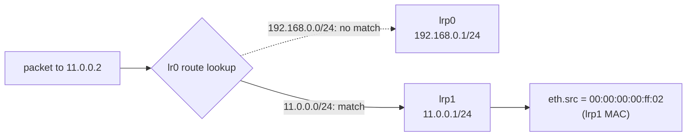

# Read Router Ports

_Your next OVN skill: predict the router's output port from the destination IP._

## The Model

A logical router port is an L3 interface. Its `networks` value also tells OVN which destination IPs are directly connected behind that port.

```text
lr0 has two router ports:

lrp0: 192.168.0.1/24, mac 00:00:00:00:ff:01
lrp1: 11.0.0.1/24,    mac 00:00:00:00:ff:02

```



## Sandbox Exercise

Run these in the sandbox shell after `./ovn-setup.sh`.

Start with the router's Northbound ports:

```sh
ovn-nbctl lrp-list lr0
ovn-nbctl list logical_router_port lrp0
ovn-nbctl list logical_router_port lrp1
```

Ask whether the router has any explicit static routes:

```sh
ovn-nbctl lr-route-list lr0
```

Now trace the familiar packet from `sw0-port1` to `sw1-port1`:

```sh
ovn-trace --minimal sw0 'inport == "sw0-port1" \
&& eth.src == 50:54:00:00:00:01 && ip4.src == 192.168.0.2 \
&& eth.dst == 00:00:00:00:ff:01 && ip4.dst == 11.0.0.2 \
&& ip.ttl == 64'
```

## What To Notice

### Connected route

`11.0.0.1/24` on `lrp1` means destinations in `11.0.0.0/24` are reachable through `lrp1`.

### No static route needed

`lr-route-list lr0` can be empty and the trace still routes, because the network is directly connected.

### Trace evidence

The trace should show `eth.src = 00:00:00:00:ff:02`, which is `lrp1`'s MAC.

## Optional Deeper Look

Find the router pipeline stage where this routing decision appears:

```sh
ovn-sbctl lflow-list lr0
```

Look for logical router ingress flow names around `lr_in_ip_routing` and matches like `ip4.dst == 11.0.0.0/24`. You do not need to master the whole output yet. Just connect the destination prefix to the chosen router port.

## Retrieval Check

Answer from memory before peeking back at the model.

**1.** Which router port handles destination `11.0.0.2`?

- lrp0
- lrp1
- sw1-port1

<details>
<summary>Answer</summary>

**lrp1**

</details>

**2.** Which router port field creates directly connected routes?

- addresses
- networks
- iface-id

<details>
<summary>Answer</summary>

**networks**

</details>

**3.** Which field becomes the output router port's MAC?

- eth.dst
- ip4.src
- eth.src

<details>
<summary>Answer</summary>

**eth.src**

</details>

## Primary Source

Read [ovn-nb.xml](../../ovn/ovn-nb.xml) for `Logical_Router_Port.networks`, then skim [ovn-logical-flows.7.rst](../../ovn/Documentation/ref/ovn-logical-flows.7.rst) section `Ingress Table 16: IP Routing`.

Keep [Reference 7: Router Port Routing Map](../reference/0007-router-port-routing-map.md) open while practicing.

If any command output is unclear, ask me to interpret it with you.
