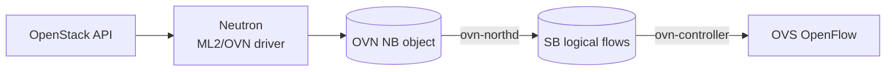

# OpenStack Neutron to OVN

_Learn how Neutron's ML2/OVN driver turns OpenStack networks, subnets, ports, routers, floating IPs, SNAT, and security groups into OVN Northbound objects you can create by hand in the sandbox._

## The Model

OpenStack users create Neutron resources through the OpenStack API. With the OVN mechanism driver enabled, Neutron writes OVN Northbound rows. After that, the path is the same OVN pipeline you already know: `ovn-northd` compiles Northbound state into Southbound logical flows, and `ovn-controller` programs local OVS.



This lesson does not run OpenStack. It recreates the OVN objects Neutron would write, using sandbox commands.

## Translation Map

Use this table when reading Neutron code or inspecting an OVN database created by OpenStack.

| OpenStack abstraction | Main source path | OVN underneath | Sandbox command family |
|---|---|---|---|
| Network | [`ovn_client.py:create_network`](../../../openstack/neutron/neutron/plugins/ml2/drivers/ovn/mech_driver/ovsdb/ovn_client.py) | `Logical_Switch` named `neutron-<network-uuid>` | `ls-add`, `set Logical_Switch` |
| Subnet with DHCP | [`ovn_client.py:create_subnet`](../../../openstack/neutron/neutron/plugins/ml2/drivers/ovn/mech_driver/ovsdb/ovn_client.py) | `DHCP_Options`, then references from logical switch ports | `create DHCP_Options`, `set Logical_Switch_Port` |
| Port | [`ovn_client.py:create_port`](../../../openstack/neutron/neutron/plugins/ml2/drivers/ovn/mech_driver/ovsdb/ovn_client.py) | `Logical_Switch_Port` named as the Neutron port UUID | `lsp-add`, `lsp-set-addresses`, `lsp-set-port-security` |
| Nova binding | [`ovn_client.py:create_port`](../../../openstack/neutron/neutron/plugins/ml2/drivers/ovn/mech_driver/ovsdb/ovn_client.py) | OVS interface with `external_ids:iface-id` matching the Neutron port ID | `ovs-vsctl add-port`, `ovn-sbctl list Port_Binding` |
| Router | [`ovn_client.py:create_router`](../../../openstack/neutron/neutron/plugins/ml2/drivers/ovn/mech_driver/ovsdb/ovn_client.py) | `Logical_Router` named `neutron-<router-uuid>` | `lr-add`, `set Logical_Router` |
| Router interface | [`ovn_client.py:create_router_port`](../../../openstack/neutron/neutron/plugins/ml2/drivers/ovn/mech_driver/ovsdb/ovn_client.py) | `Logical_Router_Port` named `lrp-<port-uuid>` plus router-type LSP | `lrp-add`, `lsp-set-type router` |
| Router gateway and SNAT | [`_add_router_ext_gw`, `update_nat_rules`](../../../openstack/neutron/neutron/plugins/ml2/drivers/ovn/mech_driver/ovsdb/ovn_client.py) | Gateway LRP, static default route, NAT row type `snat` | `lrp-add`, `lr-route-add`, `lr-nat-add ... snat` |
| Floating IP | [`_create_or_update_floatingip`](../../../openstack/neutron/neutron/plugins/ml2/drivers/ovn/mech_driver/ovsdb/ovn_client.py) | NAT row type `dnat_and_snat` | `lr-nat-add ... dnat_and_snat` |
| Security group | [`acl.py`](../../../openstack/neutron/neutron/common/ovn/acl.py) | `Port_Group` plus ACLs | `pg-add`, `pg-add-port`, `acl-add` |

## Naming Rules

Production Neutron uses UUIDs. The sandbox uses readable names so you can see the mapping.

| Neutron helper | Production form | This lesson uses |
|---|---|---|
| `ovn_name(network_id)` | `neutron-<network-uuid>` | `neutron-os-net-a` |
| `ovn_name(router_id)` | `neutron-<router-uuid>` | `neutron-os-router-a` |
| `ovn_lrouter_port_name(port_id)` | `lrp-<port-uuid>` | `lrp-os-router-if-a` |
| Neutron port ID | `<port-uuid>` | `os-port-a` |
| `ovn_port_group_name(sg_id)` | `pg-<security-group-uuid>`, dashes changed to underscores | `pg-os-sg-web` |

## Before You Start

Run this lesson in the sandbox shell. If your sandbox is fresh, recreate the tutorial topology first:

```sh
./ovn-setup.sh
```

1. `./ovn-setup.sh` creates the original tutorial topology. The OpenStack lab creates separate objects using `os-` and `neutron-` names so it does not overwrite the tutorial switches and router.

## Lab 1: Network

A Neutron network is usually represented by an OVN logical switch. Neutron names it with `neutron-<network-uuid>` and stores identity metadata in `external_ids`.

```sh
ovn-nbctl --may-exist ls-add neutron-os-net-a
ovn-nbctl set Logical_Switch neutron-os-net-a 'external_ids:"neutron:network_name"=demo-net' 'external_ids:"neutron:network_id"=os-net-a' 'external_ids:"neutron:mtu"=1442' 'external_ids:"neutron:provnet-network-type"=geneve'
ovn-nbctl show neutron-os-net-a
```

1. `ovn-nbctl --may-exist ls-add neutron-os-net-a` creates the logical switch that stands in for an OpenStack tenant network.
2. `ovn-nbctl set Logical_Switch neutron-os-net-a ...` adds Neutron-style metadata. Neutron uses `external_ids` to remember the OpenStack network name, network ID, MTU, and provider network type.
3. `ovn-nbctl show neutron-os-net-a` prints the Northbound logical switch so you can confirm the network object exists.

## Lab 2: Port

A Neutron port becomes an OVN logical switch port. In production, the LSP name is the Neutron port UUID. That exact same string is also used later as the local OVS `iface-id`.

```sh
ovn-nbctl --may-exist lsp-add neutron-os-net-a os-port-a
ovn-nbctl lsp-set-addresses os-port-a "50:54:00:00:20:10 10.20.0.10"
ovn-nbctl lsp-set-port-security os-port-a "50:54:00:00:20:10 10.20.0.10"
ovn-nbctl set Logical_Switch_Port os-port-a 'external_ids:"neutron:port_name"=demo-vm-port' 'external_ids:"neutron:port_id"=os-port-a' 'external_ids:"neutron:network_name"=neutron-os-net-a' 'external_ids:"neutron:device_owner"=compute:nova'
```

1. `ovn-nbctl --may-exist lsp-add neutron-os-net-a os-port-a` creates a logical switch port on the Neutron network. Think of `os-port-a` as a readable stand-in for a Neutron port UUID.
2. `ovn-nbctl lsp-set-addresses os-port-a "50:54:00:00:20:10 10.20.0.10"` gives the port the MAC/IP pair assigned by Neutron IPAM.
3. `ovn-nbctl lsp-set-port-security os-port-a "50:54:00:00:20:10 10.20.0.10"` limits the port to that allowed MAC/IP pair, matching Neutron port-security behavior.
4. `ovn-nbctl set Logical_Switch_Port os-port-a ...` stores Neutron metadata on the OVN row: port name, port ID, parent network name, and the `compute:nova` device owner.

Inspect it:

```sh
ovn-nbctl lsp-list neutron-os-net-a
ovn-nbctl list Logical_Switch_Port os-port-a
```

1. `ovn-nbctl lsp-list neutron-os-net-a` lists logical switch ports attached to the OpenStack-like network.
2. `ovn-nbctl list Logical_Switch_Port os-port-a` prints the full row, including addresses, port security, and `external_ids`.

## Lab 3: Subnet DHCP

A Neutron subnet is partly Neutron database state. When DHCP is enabled, ML2/OVN creates OVN `DHCP_Options` rows and attaches them to logical switch ports.

```sh
ovn-nbctl --id=@os_dhcp create DHCP_Options cidr=10.20.0.0/24 options:server_id=10.20.0.1 options:server_mac=00:00:00:00:20:01 options:lease_time=3600 options:router=10.20.0.1 options:mtu=1442 external_ids:subnet_id=os-subnet-a 'external_ids:"neutron:network_id"=os-net-a' -- set Logical_Switch_Port os-port-a dhcpv4_options=@os_dhcp
```

1. `ovn-nbctl --id=@os_dhcp create DHCP_Options ...` creates one DHCP options row for subnet `10.20.0.0/24`. The row contains the gateway/router IP, server MAC, lease time, and MTU that Neutron would derive from the subnet and network.
2. `-- set Logical_Switch_Port os-port-a dhcpv4_options=@os_dhcp` attaches that DHCP options row to the logical switch port. Neutron does this when a port should receive OVN native DHCP service.

Inspect it:

```sh
ovn-nbctl list DHCP_Options
ovn-nbctl get Logical_Switch_Port os-port-a dhcpv4_options
```

1. `ovn-nbctl list DHCP_Options` shows the DHCP rows currently in the Northbound database.
2. `ovn-nbctl get Logical_Switch_Port os-port-a dhcpv4_options` confirms that `os-port-a` references the DHCP row.

## Lab 4: Nova Binding

Neutron's source is explicit: the logical switch port name must match the local OVS interface `external_ids:iface-id` that Nova sets. That string is how `ovn-controller` knows which local interface claims which logical port.

```sh
ovs-vsctl --may-exist add-port br-int os-vif-a -- set Interface os-vif-a external_ids:iface-id=os-port-a
ovs-vsctl get Interface os-vif-a external_ids:iface-id
ovn-sbctl list Port_Binding os-port-a
```

1. `ovs-vsctl --may-exist add-port br-int os-vif-a -- set Interface os-vif-a external_ids:iface-id=os-port-a` creates a local OVS interface in the sandbox and claims the OVN logical port by setting `iface-id` to `os-port-a`.
2. `ovs-vsctl get Interface os-vif-a external_ids:iface-id` verifies the local OVS join key.
3. `ovn-sbctl list Port_Binding os-port-a` inspects the Southbound port binding created by `ovn-northd`. After local binding, this is where you look for chassis-related binding state.

## Lab 5: Router Interface

An OpenStack router becomes an OVN logical router. Adding a router interface creates a router-side LRP and connects it to the network with a router-type logical switch port.

```sh
ovn-nbctl --may-exist lr-add neutron-os-router-a
ovn-nbctl set Logical_Router neutron-os-router-a 'external_ids:"neutron:router_name"=demo-router' 'external_ids:"neutron:router_id"=os-router-a'
ovn-nbctl --may-exist lrp-add neutron-os-router-a lrp-os-router-if-a 00:00:00:00:20:01 10.20.0.1/24
ovn-nbctl --may-exist lsp-add neutron-os-net-a os-router-if-a
ovn-nbctl lsp-set-type os-router-if-a router
ovn-nbctl lsp-set-addresses os-router-if-a 00:00:00:00:20:01
ovn-nbctl lsp-set-options os-router-if-a router-port=lrp-os-router-if-a
```

1. `ovn-nbctl --may-exist lr-add neutron-os-router-a` creates the logical router representing an OpenStack router.
2. `ovn-nbctl set Logical_Router neutron-os-router-a ...` stores Neutron router identity metadata on the router row.
3. `ovn-nbctl --may-exist lrp-add neutron-os-router-a lrp-os-router-if-a 00:00:00:00:20:01 10.20.0.1/24` creates the router-side interface for the tenant subnet. In production the name would be `lrp-<neutron-router-interface-port-uuid>`.
4. `ovn-nbctl --may-exist lsp-add neutron-os-net-a os-router-if-a` creates the switch-side port that attaches the network to the router.
5. `ovn-nbctl lsp-set-type os-router-if-a router` marks the switch-side port as a router attachment, not a VM port.
6. `ovn-nbctl lsp-set-addresses os-router-if-a 00:00:00:00:20:01` sets the router MAC visible from the tenant logical switch.
7. `ovn-nbctl lsp-set-options os-router-if-a router-port=lrp-os-router-if-a` links the switch-side port to the router-side LRP.

Inspect it:

```sh
ovn-nbctl show neutron-os-router-a
ovn-sbctl lflow-list neutron-os-router-a
```

1. `ovn-nbctl show neutron-os-router-a` shows the router and its router interface.
2. `ovn-sbctl lflow-list neutron-os-router-a` shows the logical router flows compiled from the Northbound router state.

## Lab 6: Gateway + SNAT

When an OpenStack router gets an external gateway and SNAT is enabled, Neutron adds a gateway router port, a default route, and one or more `snat` NAT rows. Gateway chassis scheduling and real provider networking need a real deployment, so this lab models only the OVN NB objects.

```sh
ovn-nbctl --may-exist ls-add neutron-os-ext-net
ovn-nbctl set Logical_Switch neutron-os-ext-net 'external_ids:"neutron:network_name"=public' 'external_ids:"neutron:network_id"=os-ext-net' 'external_ids:"neutron:provnet-network-type"=flat' 'external_ids:"neutron:provnet-physical-network"=physnet1'
ovn-nbctl --may-exist lrp-add neutron-os-router-a lrp-os-gw 00:00:00:00:ee:01 172.24.4.10/24
ovn-nbctl --may-exist lsp-add neutron-os-ext-net os-gw-port
ovn-nbctl lsp-set-type os-gw-port router
ovn-nbctl lsp-set-addresses os-gw-port 00:00:00:00:ee:01
ovn-nbctl lsp-set-options os-gw-port router-port=lrp-os-gw
ovn-nbctl lr-route-add neutron-os-router-a 0.0.0.0/0 172.24.4.1
ovn-nbctl --may-exist lr-nat-add neutron-os-router-a snat 172.24.4.10 10.20.0.0/24
```

1. `ovn-nbctl --may-exist ls-add neutron-os-ext-net` creates a logical switch representing the external provider network.
2. `ovn-nbctl set Logical_Switch neutron-os-ext-net ...` marks the switch with Neutron provider-network metadata such as `flat` and `physnet1`.
3. `ovn-nbctl --may-exist lrp-add neutron-os-router-a lrp-os-gw 00:00:00:00:ee:01 172.24.4.10/24` creates the router's gateway-side LRP with an address on the external network.
4. `ovn-nbctl --may-exist lsp-add neutron-os-ext-net os-gw-port` creates the external switch-side attachment port.
5. `ovn-nbctl lsp-set-type os-gw-port router` marks the external switch port as a router attachment.
6. `ovn-nbctl lsp-set-addresses os-gw-port 00:00:00:00:ee:01` sets the MAC address used on the external logical switch.
7. `ovn-nbctl lsp-set-options os-gw-port router-port=lrp-os-gw` links the external switch-side port to the gateway LRP.
8. `ovn-nbctl lr-route-add neutron-os-router-a 0.0.0.0/0 172.24.4.1` creates the router's default route toward the external gateway IP.
9. `ovn-nbctl --may-exist lr-nat-add neutron-os-router-a snat 172.24.4.10 10.20.0.0/24` creates a SNAT rule translating tenant source addresses from `10.20.0.0/24` to external address `172.24.4.10`.

Inspect it:

```sh
ovn-nbctl lr-route-list neutron-os-router-a
ovn-nbctl lr-nat-list neutron-os-router-a
```

1. `ovn-nbctl lr-route-list neutron-os-router-a` shows the default route created for the external gateway.
2. `ovn-nbctl lr-nat-list neutron-os-router-a` shows the router NAT table, including the SNAT row.

## Lab 7: Floating IP

A Neutron floating IP is represented by an OVN NAT row with type `dnat_and_snat`. This maps one external address to one internal port/IP in both directions.

```sh
ovn-nbctl --may-exist lr-nat-add neutron-os-router-a dnat_and_snat 172.24.4.101 10.20.0.10 os-port-a 50:54:00:00:20:10
ovn-nbctl set Logical_Switch_Port os-port-a 'external_ids:"neutron:port_fip"=172.24.4.101'
ovn-nbctl lr-nat-list neutron-os-router-a
```

1. `ovn-nbctl --may-exist lr-nat-add neutron-os-router-a dnat_and_snat 172.24.4.101 10.20.0.10 os-port-a 50:54:00:00:20:10` creates the floating-IP NAT row. External IP `172.24.4.101` maps to internal IP `10.20.0.10` on logical port `os-port-a`.
2. `ovn-nbctl set Logical_Switch_Port os-port-a 'external_ids:"neutron:port_fip"=172.24.4.101'` records the floating IP on the private logical switch port, matching Neutron's habit of annotating the LSP for related consumers.
3. `ovn-nbctl lr-nat-list neutron-os-router-a` verifies both the SNAT and floating-IP NAT rows on the router.

## Lab 8: Security Group

Neutron security groups are modeled as OVN port groups plus ACLs. Security group rules become ACLs against the port group. Neutron commonly uses priority `1002` for allow rules and action `allow-related` for stateful behavior.

```sh
ovn-nbctl --may-exist pg-add pg-os-sg-web
ovn-nbctl pg-add-port pg-os-sg-web os-port-a
ovn-nbctl --may-exist acl-add pg-os-sg-web to-lport 1002 'outport == @pg-os-sg-web && ip4 && tcp && tcp.dst == 22' allow-related
ovn-nbctl --may-exist acl-add pg-os-sg-web from-lport 1002 'inport == @pg-os-sg-web && ip4' allow-related
ovn-nbctl acl-list pg-os-sg-web
```

1. `ovn-nbctl --may-exist pg-add pg-os-sg-web` creates the OVN port group that represents a Neutron security group.
2. `ovn-nbctl pg-add-port pg-os-sg-web os-port-a` adds the VM logical switch port to the security group target set.
3. `ovn-nbctl --may-exist acl-add pg-os-sg-web to-lport 1002 'outport == @pg-os-sg-web && ip4 && tcp && tcp.dst == 22' allow-related` creates an ingress-style allow rule for IPv4 TCP port 22 to any port in the group.
4. `ovn-nbctl --may-exist acl-add pg-os-sg-web from-lport 1002 'inport == @pg-os-sg-web && ip4' allow-related` creates an egress-style allow rule for IPv4 traffic leaving any port in the group.
5. `ovn-nbctl acl-list pg-os-sg-web` prints the ACLs attached to the port group.

## What The Sandbox Cannot Fully Show

### OpenStack API and DB

The sandbox cannot show Neutron API validation, quota checks, SQL state, revision tracking, or RPC/event sequencing.

### Provider Networks

Real flat/VLAN provider networks need bridge mappings, physical NICs, gateway chassis scheduling, and external reachability. The dummy sandbox can model the NB rows, not the real underlay.

### Metadata and DHCP Agents

OVN native DHCP rows are visible, but OpenStack metadata service behavior and deployment-specific options need a real cloud.

### Octavia Load Balancers

Core Neutron floating IPs are covered here. OpenStack load balancers live mostly in Octavia and need a separate lesson/source checkout.

## Cleanup

Remove the lesson-created objects when you are done:

```sh
ovn-nbctl clear Logical_Switch_Port os-port-a dhcpv4_options
ovn-nbctl --bare --columns=_uuid find DHCP_Options external_ids:subnet_id=os-subnet-a | xargs -r -n1 ovn-nbctl dhcp-options-del
ovs-vsctl --if-exists del-port os-vif-a
ovn-nbctl --if-exists pg-del pg-os-sg-web
ovn-nbctl --if-exists lr-del neutron-os-router-a
ovn-nbctl --if-exists ls-del neutron-os-ext-net
ovn-nbctl --if-exists ls-del neutron-os-net-a
```

1. `ovn-nbctl clear Logical_Switch_Port os-port-a dhcpv4_options` detaches the DHCP options row from the VM logical switch port before deleting the row.
2. `ovn-nbctl --bare --columns=_uuid find DHCP_Options external_ids:subnet_id=os-subnet-a | xargs -r -n1 ovn-nbctl dhcp-options-del` finds lesson DHCP rows by subnet metadata and deletes them.
3. `ovs-vsctl --if-exists del-port os-vif-a` removes the local OVS interface used to demonstrate Nova binding.
4. `ovn-nbctl --if-exists pg-del pg-os-sg-web` deletes the security-group-like port group and its ACLs.
5. `ovn-nbctl --if-exists lr-del neutron-os-router-a` deletes the logical router, including its router ports, routes, and NAT rows.
6. `ovn-nbctl --if-exists ls-del neutron-os-ext-net` deletes the external-network logical switch.
7. `ovn-nbctl --if-exists ls-del neutron-os-net-a` deletes the tenant-network logical switch and remaining switch ports.

## Retrieval Check

Answer from memory before peeking back at the tables.

**1.** What OVN object is behind a normal Neutron network?

- Logical router
- Logical switch
- Port binding

<details>
<summary>Answer</summary>

**Logical switch**

</details>

**2.** Which OVS external ID must match the Neutron port ID?

- iface-id
- router-id
- subnet-id

<details>
<summary>Answer</summary>

**iface-id**

</details>

**3.** Which OVN NAT type backs a Neutron floating IP?

- snat
- dnat_and_snat
- load_balance

<details>
<summary>Answer</summary>

**dnat_and_snat**

</details>

**4.** What OVN object represents a Neutron security group target set?

- DHCP row
- NAT rule
- Port group

<details>
<summary>Answer</summary>

**Port group**

</details>

## Primary Sources

Read these next to the lesson: [`ovn_client.py`](../../../openstack/neutron/neutron/plugins/ml2/drivers/ovn/mech_driver/ovsdb/ovn_client.py), [`commands.py`](../../../openstack/neutron/neutron/plugins/ml2/drivers/ovn/mech_driver/ovsdb/commands.py), [`utils.py`](../../../openstack/neutron/neutron/common/ovn/utils.py), [`constants.py`](../../../openstack/neutron/neutron/common/ovn/constants.py), [`acl.py`](../../../openstack/neutron/neutron/common/ovn/acl.py), and [`services/ovn_l3/plugin.py`](../../../openstack/neutron/neutron/services/ovn_l3/plugin.py).

For command syntax, keep [`ovn-nbctl.8.xml`](../../ovn/utilities/ovn-nbctl.8.xml) open. If any output is unclear, ask me to interpret it with you.
