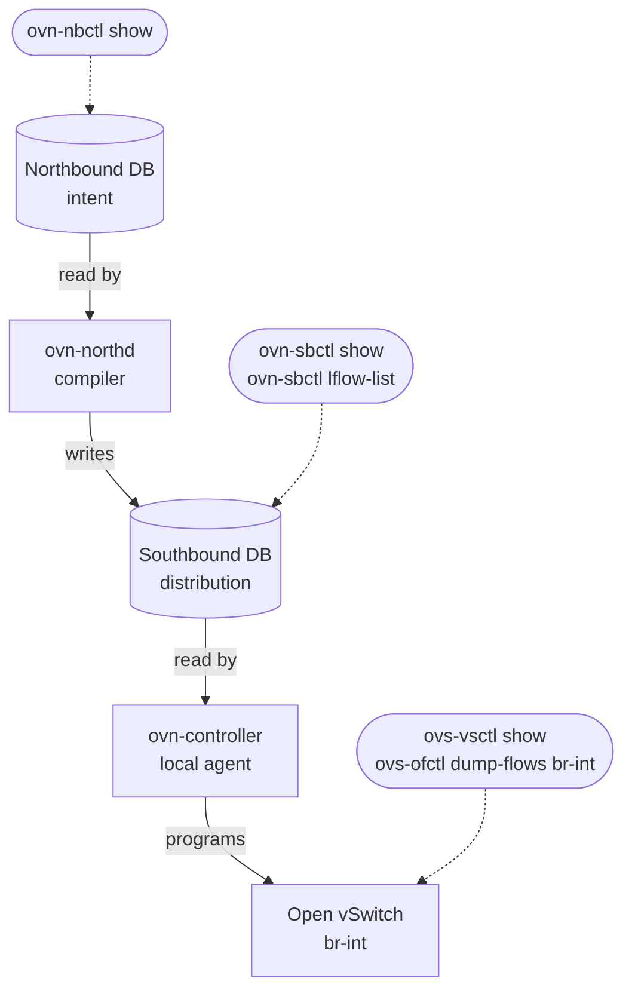

# OVN Control Plane Map

_A compact map for deciding which command to use in the sandbox._

## Northbound DB

The intent layer. It stores logical switches, logical routers, ACLs, and other desired logical network configuration.

**Sandbox command:** `ovn-nbctl show`  
**Manual:** [ovn-nbctl(8)](https://www.ovn.org/support/dist-docs/ovn-nbctl.8.html)

## `ovn-northd`

The compiler. It reads Northbound intent and writes lower-level logical datapath information into the Southbound DB.

**Look for output with:** `ovn-sbctl lflow-list`

## Southbound DB

The distribution layer. It contains logical flows, port bindings, chassis information, and data consumed by controllers.

**Sandbox command:** `ovn-sbctl show`  
**Manual:** [ovn-sbctl(8)](https://www.ovn.org/support/dist-docs/ovn-sbctl.8.html)

## `ovn-controller`

The local agent. It reads Southbound data and programs Open vSwitch on a chassis.

**Sandbox commands:** `ovs-vsctl show`, `ovs-ofctl dump-flows br-int`  
**Manual:** [ovs-vsctl(8)](https://www.openvswitch.org/support/dist-docs/ovs-vsctl.8.txt)

## One Sentence

OVN turns logical intent in the Northbound DB into distributed datapath behavior through `ovn-northd`, the Southbound DB, and `ovn-controller`.

## Primary Sources

Use [local `ovn-architecture.7`](../../ovn/ovn-architecture.7) and [local sandbox tutorial](../../ovn/Documentation/tutorials/ovn-sandbox.rst).
