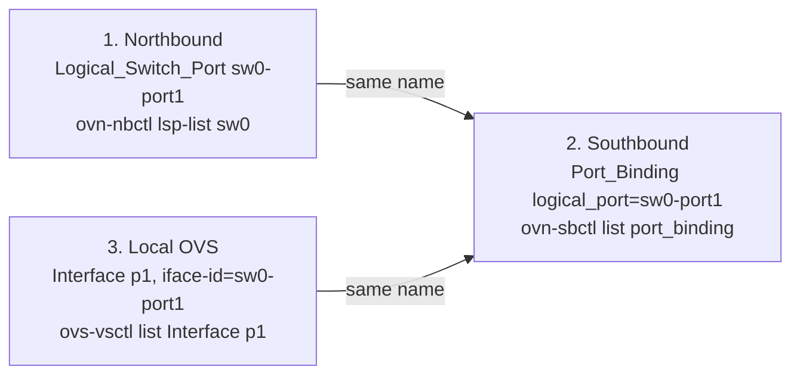

# Port Binding Map

_Use this when you need to map an OVN logical port to local OVS._

## One-String Join

```text
logical port name == Port_Binding.logical_port == Interface.external_ids:iface-id
```

In the sandbox, `sw0-port1` is the logical name and `p1` is the local OVS interface that claims it.



## 1. Northbound

`ovn-nbctl lsp-list sw0`

`ovn-nbctl lsp-get-addresses sw0-port1`

Shows the configured logical switch port and its MAC/IP addresses.

## 2. Southbound

`ovn-sbctl list port_binding sw0-port1`

Shows the compiled binding row. Useful fields: `logical_port`, `chassis`, `mac`, `type`, and `up`.

## 3. Local OVS

`ovs-vsctl list Interface p1`

Shows the local interface. The key field is `external_ids:iface-id`.

## Sandbox Examples

```text
p1 claims sw0-port1
p2 claims sw1-port1
```

These claims are created by `ovn/tutorial/ovn-setup.sh` with `ovs-vsctl add-port br-int ... external_ids:iface-id=...`.

## Primary Sources

Use local [`ovn-sb.5`](../../ovn/ovn-sb.5) for `Port_Binding`, local [`ovn-nbctl.8`](../../ovn/utilities/ovn-nbctl.8.xml) for logical switch port commands, and [`ovn-setup.sh`](../../ovn/tutorial/ovn-setup.sh) for the sandbox's concrete bindings.
