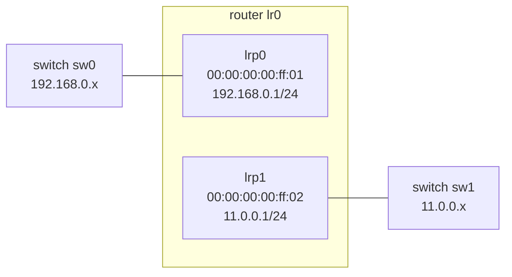

# Router Port Routing Map

_A compact guide for reading directly connected routes in the OVN sandbox router._

## Core Idea

A logical router port is both an interface and a source of directly connected routes.



## Commands

```sh
ovn-nbctl lrp-list lr0
ovn-nbctl list logical_router_port lrp0
ovn-nbctl list logical_router_port lrp1
ovn-nbctl lr-route-list lr0
ovn-sbctl lflow-list lr0
ovn-trace --minimal sw0 'inport == "sw0-port1"
&& eth.src == 50:54:00:00:00:01 && ip4.src == 192.168.0.2
&& eth.dst == 00:00:00:00:ff:01 && ip4.dst == 11.0.0.2
&& ip.ttl == 64'
```

## How To Read It

### Input

The packet enters router `lr0` from switch `sw0` through router port `lrp0`.

### Destination

`ip4.dst == 11.0.0.2` belongs to `11.0.0.0/24`, so the matching router port is `lrp1`.

### Rewrite

The router decrements TTL, changes Ethernet source to `lrp1`'s MAC, and resolves the destination host MAC.

## Route Kinds

Connected routes come from router port networks. Static routes come from explicit `Logical_Router_Static_Route` rows, usually added with `ovn-nbctl lr-route-add`.

```sh
# connected route source
ovn-nbctl lrp-add lr0 lrp1 00:00:00:00:ff:02 11.0.0.1/24

# static route command shape
ovn-nbctl lr-route-add ROUTER PREFIX NEXTHOP [PORT]
```

## Primary Sources

[ovn-nb.xml](../../ovn/ovn-nb.xml) documents `Logical_Router_Port.networks` and static route fields.

[ovn-logical-flows.7.rst](../../ovn/Documentation/ref/ovn-logical-flows.7.rst) documents logical router IP routing flows.

[ovn-nbctl.8.xml](../../ovn/utilities/ovn-nbctl.8.xml) documents `lrp-list`, `lr-route-add`, and `lr-route-list`.

[Back to Lesson 7](../lessons/0007-read-router-ports.md)
